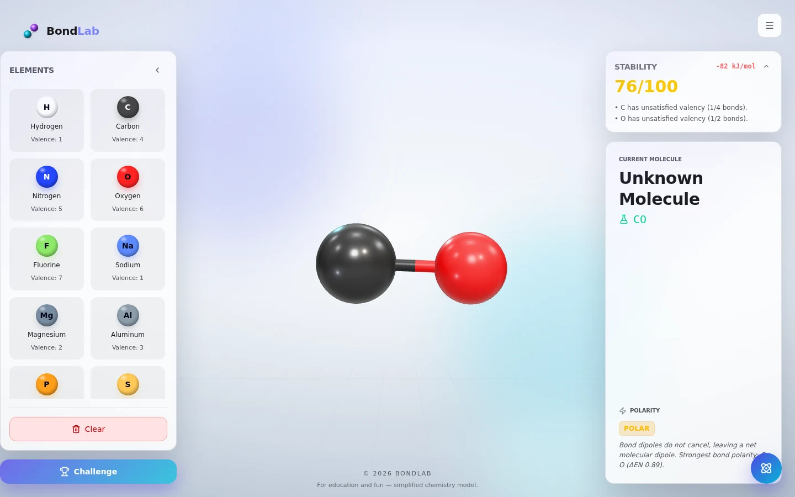
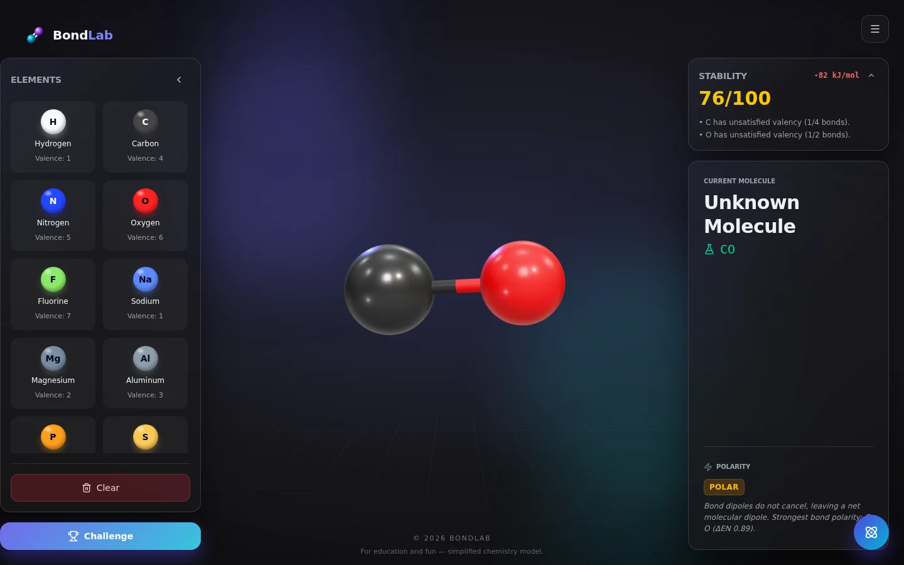
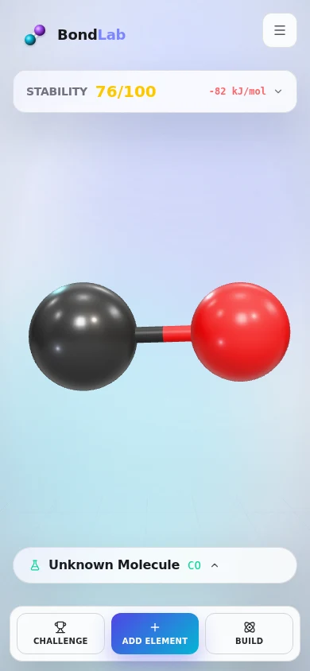
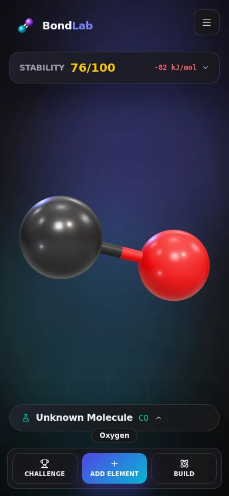
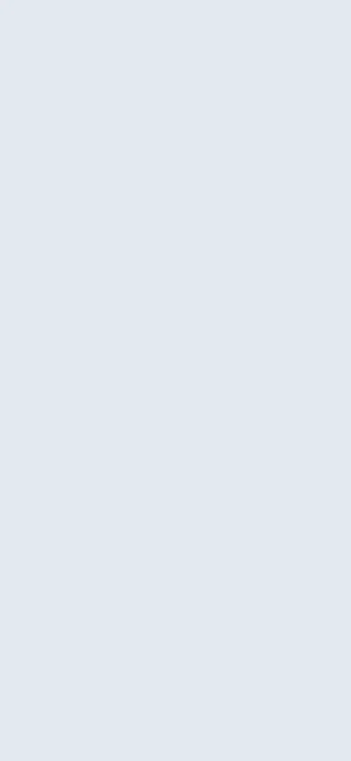
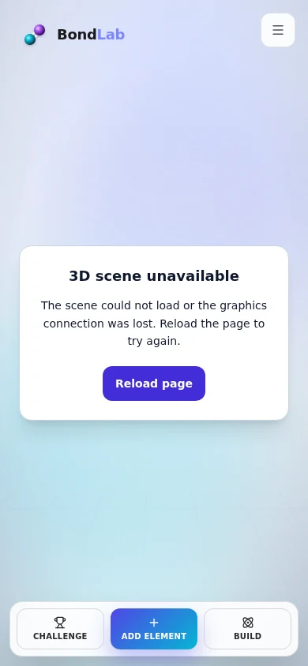
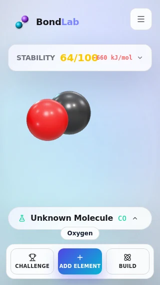
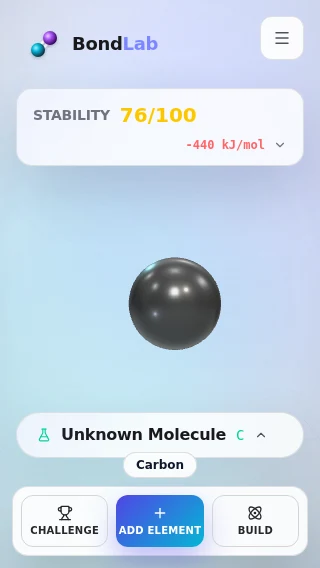

# Bond Lab independent browser acceptance — 2026-10-21

## Scope and environment

Production tested: https://bondlab.orangely.xyz/ at main `3c0b3b84d717eb11e039a34830ec437b5b94c662` (merge of PR #4; reviewed head `d15d939d26350fefeaac4f68e5dae0b2eec1eeec`). Production asset names, including `Scene-DP_sDFvK.js`, match the baseline local production build. Main remained unchanged during the audit.

Browser: Chrome for Testing 155.0.8059.84 on Linux, Playwright, WebGL through SwiftShader. This is a real browser with software rendering. Mobile tests use viewport, touch and CDP touch/pinch simulation; they are **not iOS Safari or physical-device tests**. Production checks and local repaired-build checks are distinguished below.

## Results

| Scenario | Production baseline | Repaired build |
| --- | --- | --- |
| 1440×900, light/dark | Glossy atoms, reflection/light rig, transparent backdrop render; no shader link failures | Same visual treatment; actual pointer operations pass |
| 390×844, light/dark | Scene and mobile element drawer render | Touch selection, bonds, dragging, deletion, orbit and pinch pass |
| 320×568, light/dark | Scene renders, but score/energy overlap | Readouts wrap without overlap |
| 844×390 viewport | Scene renders with desktop panels; panels scroll in the short viewport | Additional touch-context rendering smoke passes; desktop layout remains intentionally unchanged |
| Element symbols, 15 elements × desktop/mobile × light/dark | All sampled glyph backgrounds ≥4.5:1 | Swatch styles unchanged |
| Scene chunk download aborted | Entire app becomes blank | Scene fallback, reload action, UI and navigation remain available |
| WebGL creation denied | No useful failure message; initialization rejects outside React boundary | Themed, localized fallback; no unhandled page rejection |
| Runtime WebGL context loss | No acceptance claim | Actual `WEBGL_lose_context` extension triggers fallback and removes canvas |
| Rapid atom click | Can leave drag active; reproduced on an untouched baseline worktree | Pointer session finishes synchronously |
| Two-atom click-to-bond | Second pointerdown clears the source selection | Atom selection survives until bond creation |
| Reduce Motion | Backdrop/spawn suppression exists, but mobile menu still slides and drawer transitions remain | Menu/drawer motion removed; new atom scale stays 1; selection halo and editing feedback still work |
| Repeated SPA route entry/exit | 12 cycles show bounded resources | 12 cycles in production-build probe and 12-cycle automated regression pass |
| Theme switches within one scene | Separate initial themes tested | 10 switches retain one context and constant resource counts |

## Confirmed defects and repairs

1. **Rendering failure isolation.** A boundary inside the lazy scene cannot catch failure to download that same module. Fiber's DOM Canvas also invokes async renderer configuration without forwarding its rejection to React. The boundary now wraps the scene import. `SceneCanvas` owns and awaits configuration, forwards scene render errors, observes context loss, disconnects resize/pointer infrastructure and disposes its root and renderer on exit. A fresh canvas per effect prevents delayed cleanup from acting on a StrictMode replacement.
2. **Pointer session ownership.** Atom drag listeners were installed in an effect, so a fast `pointerup` could arrive first. Registration now happens synchronously on pointerdown, with one cleanup path for release, cancel, blur and unmount. Bond rotation uses the same session ownership, including removal of window listeners on unmount. Clearing an already-null bond selection no longer destroys the atom selected as the source of a new bond.
3. **Reduced motion gaps.** Mobile menu keyframes and UI transform transitions now obey the media preference. Immediate operational feedback remains.
4. **Small-screen readout overlap.** The collapsed stability summary wraps its two groups when they do not fit, instead of shrinking one group over the other.

PR #4's full PMREM target disposal is preserved. The generation room and generator scratch allocations are now released after environment creation; the output target remains owned by the scene effect and is released at unmount. This is not a claim that the already-fixed PR #4 target leak persisted.

## GPU evidence and limits

The probe wraps actual WebGL `create*`/`delete*` methods before app load and records `webglcontextlost`; it does not use a mocked renderer. After each baseline return, there was exactly one non-lost context, with 7 textures, 5 framebuffers and 1 renderbuffer. The repaired production build consistently retained 6 textures, 4 framebuffers and 1 renderbuffer; theme switches did not change these totals. Shader link failures were empty. Departed contexts became lost instead of accumulating as live contexts.

The counter intentionally retains JavaScript references for inspection. A lost context's remaining handle entries are **not** live GPU allocations: context loss releases its resources even when there was no matching individual delete call. Accordingly these counts show bounded WebGL ownership over the measured cycles, not physical VRAM usage or proof against every long-running driver leak. No hours-long or real-device GPU profiling was performed.

## Rendered contrast method

For each symbol, capture its rendered orb, temporarily make only the text transparent, and capture the exact background under its glyph pixels. Measure foreground/background luminance contrast at changed glyph pixels (channel difference threshold 24 to exclude near-transparent antialias fringes). This includes the actual CSS gradients and shadows, rather than checking only the base element color. All 60 cases passed. Minimum: potassium **4.5765:1**; copper **4.5917:1**. This measurement concerns element symbols, not every other UI label.

Raw viewport, resource and contrast readings: [measurements.json](measurements.json).

## Screenshots

Repaired desktop scene, light and dark:

Repaired mobile scene, light and dark (Chromium touch simulation):

Failed module load before; visible recovery after (WebGL creation denial):

320px score/energy overlap before; wrapped readouts after. Atom content differs because these are independent browser sessions:

## Validation

- `npm run verify`: **144/144 tests**, TypeScript check and production build pass.
- Playwright: **15/15 tests** pass. Includes existing app flows, mouse/touch interactions in both themes, bond creation/upgrade/removal, atom deletion, orbit/zoom/pinch, reduced-motion scale/feedback, initialization/import/context-loss failures, 320px geometry and 12 repeated route cycles.
- New failure regressions were observed failing before their fixes. The rapid-click regression also failed on an untouched baseline checkout.
- Existing E2E setup now dismisses onboarding explicitly, clicks the exposed part of the mobile menu backdrop, and checks the translated closed drawer against the viewport instead of DOM visibility.
- `git diff --check` passes.
- This restricted execution environment requires Vite to bind `127.0.0.1`, so browser tests used a temporary config inheriting `playwright.config.ts` and overriding only the server host/cwd; Chromium was selected using `PLAYWRIGHT_CHROMIUM_PATH`. Application behavior was not mocked. The normal project configuration is unchanged.
- CI is manual (`workflow_dispatch`) in this repository. No extra CI run was triggered.

## Still requires physical devices

- iPhone/iPad Safari: real touch/pinch/pointer cancellation, dynamic browser bars, safe areas and portrait/landscape changes.
- Safari WebGL/shader/material rendering on Apple GPUs, background/foreground transitions and memory-pressure context loss.
- Longer GPU-memory/thermal/battery observation with repeated navigation on real iOS/Android hardware.

The repaired code is proposed in a separate PR. These local results do not claim the repaired build is already deployed.
